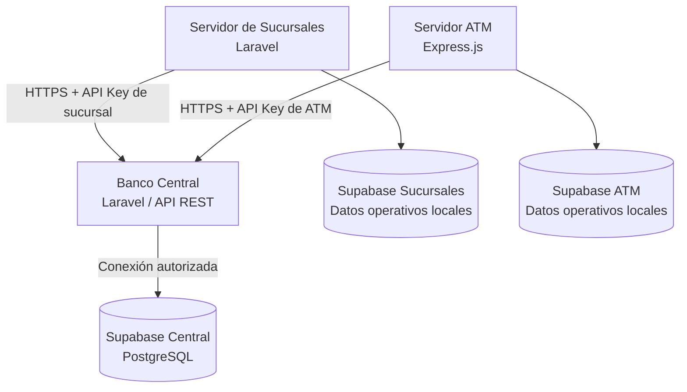

# Banco Central — Sistema Bancario Distribuido

> **Estado del proyecto:** en desarrollo. Este README es una versión inicial y se actualizará cuando el equipo publique el código y despliegue la aplicación.

## Descripción

El **Banco Central** es el núcleo del Sistema Bancario Distribuido desarrollado como examen práctico. Su responsabilidad es administrar los datos maestros de las cuentas bancarias, mantener los **saldos oficiales**, registrar las transacciones globales y autorizar las operaciones solicitadas por las sucursales y los cajeros automáticos (ATM).

La aplicación está planeada con **Laravel (PHP)** y **Supabase (PostgreSQL)**. El despliegue previsto por el equipo es **Vercel**, sujeto a la adaptación y verificación de compatibilidad de Laravel con ese entorno.

## Arquitectura general



**Principio fundamental:** el Banco Central conserva la autoridad sobre los saldos y las transacciones. Sucursales y ATM no deben modificar los saldos oficiales directamente; deben utilizar los endpoints autorizados del Banco Central.

## Responsabilidades del Banco Central

- Administrar cuentas bancarias, sus estados y saldos oficiales.
- Registrar y consultar el historial global de transacciones.
- Dar de alta sucursales y cajeros automáticos.
- Asignar responsables y controlar el efectivo reportado de los nodos.
- Generar, validar y revocar credenciales API por nodo.
- Autorizar operaciones bancarias de acuerdo con los permisos del nodo.
- Proporcionar consultas y reportes administrativos.
- Evitar saldos negativos, operaciones duplicadas y modificaciones no autorizadas.

## Tecnologías previstas

| Tecnología | Uso |
| --- | --- |
| PHP / Laravel | Backend y API del Banco Central |
| Composer | Gestión de dependencias PHP |
| Supabase / PostgreSQL | Persistencia de cuentas, nodos y transacciones |
| Supabase Auth | Autenticación de administradores, según implementación |
| GitHub | Control de versiones |
| Vercel | Plataforma de despliegue acordada por el equipo |

## Base de datos central

El esquema inicial contempla las siguientes tablas:

| Tabla | Propósito |
| --- | --- |
| `branches` | Sucursales, responsables, estado y efectivo disponible |
| `atms` | Cajeros, sucursal asociada, responsables y efectivo reportado |
| `users_accounts` | Cuentas bancarias y saldos oficiales |
| `node_api_keys` | Credenciales de autenticación de sucursales y ATM (almacenadas como hash) |
| `admin_users` | Administradores y roles |
| `transactions` | Registro global de operaciones bancarias |
| `node_cash_movements` | Entradas y salidas de efectivo físico de los nodos |

La base de datos utiliza identificadores UUID, montos con precisión decimal, restricciones de integridad y controles de acceso mediante RLS. La configuración concreta debe revisarse junto con el backend implementado.

## Reglas de negocio principales

1. El número de cuenta debe ser único.
2. Los saldos oficiales se consultan en el Banco Central.
3. No se autorizan operaciones sobre cuentas bloqueadas o cerradas.
4. Los importes deben ser positivos y representarse con precisión decimal.
5. El saldo no puede ser negativo.
6. Cada operación monetaria debe registrarse en el historial global.
7. Las operaciones repetidas deben identificarse mediante una clave de idempotencia para evitar cargos duplicados.
8. La actualización del saldo y el registro de la transacción deben realizarse de forma atómica.
9. Cada sucursal y ATM debe autenticarse con una credencial independiente y revocable.

## Contrato inicial de la API (propuesto)

Estos endpoints aparecen en el documento de planificación del equipo. **Todavía no se ha confirmado que estén implementados** y podrían cambiar durante el desarrollo.

| Método | Endpoint previsto | Función |
| --- | --- | --- |
| `POST` | `/api/v1/branches/accounts` | Registrar una cuenta desde una sucursal autorizada |
| `GET` | `/api/v1/accounts/{accountNumber}/balance` | Consultar saldo oficial |
| `GET` | `/api/v1/accounts/{accountNumber}/transactions` | Consultar transacciones de una cuenta |
| `POST` | `/api/v1/atm/withdrawals` | Solicitar un retiro desde un ATM |
| `POST` | `/api/v1/atm/deposits` | Registrar un depósito desde un ATM |
| `GET` | `/api/v1/admin/transactions` | Consultar el historial global para administración |

La documentación definitiva de rutas, parámetros, respuestas, autenticación y códigos HTTP se publicará mediante **OpenAPI** cuando el código esté disponible.

## Configuración local (pendiente de validar con el código)

Cuando el repositorio contenga una aplicación Laravel, el procedimiento habitual será:

```bash
git clone https://github.com/Robel42-web/Banco_central.git
cd Banco_central
composer install
cp .env.example .env
php artisan key:generate
```

Después se deberán configurar las variables de entorno y ejecutar las migraciones o comandos que el equipo confirme. **No ejecutes migraciones sobre Supabase sin revisar antes si las tablas ya existen.**

### Variables de entorno de referencia

Los nombres exactos deben coincidir con la implementación del backend. Este bloque contiene únicamente ejemplos, **nunca credenciales reales**.

```dotenv
APP_ENV=local
APP_DEBUG=true
APP_KEY=

DB_CONNECTION=pgsql
DB_HOST=HOST_POSTGRES_SUPABASE
DB_PORT=5432
DB_DATABASE=postgres
DB_USERNAME=USUARIO_POSTGRES
DB_PASSWORD=CONTRASENA_PRIVADA
DB_SSLMODE=require

SUPABASE_URL=https://PROYECTO.supabase.co
SUPABASE_PUBLISHABLE_KEY=CLAVE_PUBLICABLE
SUPABASE_SECRET_KEY=CLAVE_SECRETA_SOLO_BACKEND
```

> El proyecto podría utilizar conexión PostgreSQL directa, API de Supabase o ambas. No todas las variables anteriores serán necesarias en todos los casos. La configuración se ajustará al código real.

**Seguridad:** nunca subir `.env`, contraseñas de base de datos, tokens de GitHub ni claves secretas a GitHub. Mantener únicamente un `.env.example` con valores ficticios. Las claves de Supabase con privilegios elevados deben utilizarse exclusivamente en el servidor.

## Despliegue previsto en Vercel

El equipo acordó utilizar **Vercel para los tres nodos**, con autorización del profesor. Este repositorio se vinculará a un proyecto independiente de Vercel.

**Importante:** Laravel no dispone del mismo entorno PHP persistente que ofrece un servidor convencional en Vercel. Antes de desplegar será necesario verificar la estrategia de ejecución de PHP, las rutas, las dependencias, el almacenamiento temporal y las variables de entorno. No se debe considerar completado el despliegue hasta comprobar que la API responde correctamente.

- **Repositorio:** https://github.com/Robel42-web/Banco_central
- **URL pública:** pendiente de despliegue.
- **Despliegue automático desde GitHub:** pendiente de configurar y verificar.
- **Pruebas de integración:** pendientes.

## Prueba funcional esperada

1. Banco Central registra una sucursal y un ATM, con sus credenciales y efectivo disponible.
2. Una sucursal autorizada registra una cuenta con saldo inicial de **$1,000 MXN**.
3. Banco Central verifica el registro y el saldo.
4. Un ATM autorizado solicita un retiro de **$300 MXN**.
5. Banco Central comprueba que el saldo oficial queda en **$700 MXN** y que existe el registro de la transacción.

Esta secuencia corresponde a la demostración prevista; **no implica que las pruebas ya hayan sido ejecutadas**.

## Documentación adicional (pendiente)

- Archivo OpenAPI (`openapi.yaml` o equivalente).
- Capturas de pruebas y respuestas de la API.
- URL pública de Vercel.
- Evidencia de despliegue continuo desde GitHub.
- Instrucciones definitivas de instalación y pruebas.

## Equipo y repositorios relacionados

- **Banco Central:** https://github.com/Robel42-web/Banco_central
- **Servidor Sucursales:** https://github.com/Robel42-web/Servidor_sucursales
- **Servidor ATM:** https://github.com/Robel42-web/Servidor_atm

Proyecto académico: **Examen Práctico — Sistema Bancario Distribuido**.