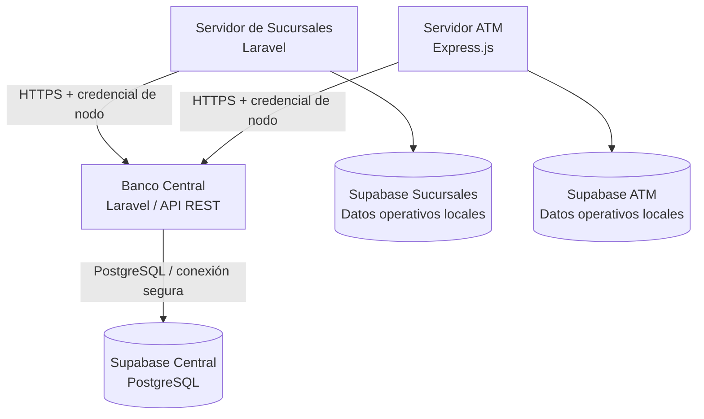

# Banco Central — Sistema Bancario Distribuido


## Descripción

El **Banco Central** es el núcleo del **Sistema Bancario Distribuido**, desarrollado como examen práctico. Su responsabilidad es administrar las cuentas bancarias y sus **saldos oficiales**, registrar las transacciones globales y autorizar las operaciones solicitadas por sucursales y cajeros automáticos (ATM).

El backend utiliza **Laravel 13 (PHP)** y la base de datos central se encuentra en **Supabase (PostgreSQL)**. El equipo eligió **Vercel** para desplegar sus tres servicios, con autorización del profesor.

## Arquitectura general



**Principio fundamental:** el Banco Central conserva la autoridad sobre los saldos y las transacciones. Las sucursales y los ATM deben solicitar las operaciones mediante la API autorizada, sin modificar directamente los saldos oficiales.

## Estado de avance

| Componente | Estado | Observaciones |
| --- | --- | --- |
| Repositorio GitHub | Disponible | Contiene el proyecto Laravel y archivos de configuración. |
| Backend Laravel | Código incorporado | Proyecto con `app/`, `bootstrap/`, `config/`, `routes/`, `database/`, `public/` y `tests/`. |
| Supabase Central | Creado | Esquema central con siete tablas. |
| Integración GitHub–Vercel | Configurada | Vercel genera despliegues a partir del repositorio. |
| Compilación en Vercel | Completada | El último despliegue observado figura como `Ready`. |
| Ejecución de Laravel | **Con incidencia** | Las solicitudes a `/` y `/up` devuelven **HTTP 500**. |
| Conectividad funcional con Supabase | Pendiente de validar | No se ha confirmado una operación exitosa desde la API desplegada. |
| Endpoints bancarios | Pendientes de verificación | Es necesario contrastar las rutas propuestas con `routes/api.php`. |
| Prueba integrada con sucursal y ATM | Pendiente | No hay evidencia de una prueba completa de extremo a extremo. |

## Responsabilidades del Banco Central

- Administrar cuentas bancarias, sus estados y saldos oficiales.
- Registrar y consultar el historial global de transacciones.
- Dar de alta sucursales y cajeros automáticos.
- Controlar el efectivo reportado por los nodos.
- Gestionar credenciales API independientes y revocables por nodo.
- Autorizar operaciones de acuerdo con los permisos correspondientes.
- Proporcionar consultas y reportes administrativos.
- Prevenir operaciones duplicadas, saldos negativos y modificaciones no autorizadas.

Estas son las **responsabilidades definidas para el módulo**; su implementación completa debe verificarse mediante pruebas.

## Tecnologías utilizadas

| Tecnología | Uso |
| --- | --- |
| PHP 8.3 o superior | Lenguaje requerido por el proyecto. |
| Laravel 13 | Backend y API REST. |
| Laravel Sanctum 4 | Dependencia de autenticación incluida en `composer.json`. |
| Composer | Instalación de dependencias PHP. |
| Supabase / PostgreSQL | Base de datos central. |
| Vite / Node.js | Construcción de recursos frontend incluidos en el proyecto. |
| GitHub | Repositorio y control de versiones. |
| Vercel | Plataforma de despliegue. |
| `vercel-php@0.8.0` | Runtime PHP comunitario configurado en `vercel.json`; compatibilidad operativa todavía en revisión. |

## Base de datos central

El proyecto **banco-central** de Supabase contiene las siguientes tablas:

| Tabla | Propósito |
| --- | --- |
| `branches` | Sucursales, responsables, estado y efectivo disponible. |
| `atms` | Cajeros, sucursal asociada, responsables y efectivo reportado. |
| `users_accounts` | Cuentas bancarias y saldos oficiales. |
| `node_api_keys` | Credenciales de acceso para sucursales y ATM. |
| `admin_users` | Administradores y roles. |
| `transactions` | Historial global de operaciones bancarias. |
| `node_cash_movements` | Entradas y salidas de efectivo físico de los nodos. |

El esquema utiliza identificadores UUID, montos decimales y controles de acceso. Se han configurado políticas y restricciones de seguridad en Supabase. La compatibilidad exacta entre el esquema y los modelos del backend debe validarse.

## Reglas de negocio previstas

1. El número de cuenta debe ser único.
2. Los saldos oficiales se administran en el Banco Central.
3. No se deben autorizar operaciones sobre cuentas bloqueadas o cerradas.
4. Los importes deben ser positivos y manejar precisión decimal.
5. No se deben permitir saldos negativos.
6. Toda operación monetaria debe quedar registrada.
7. Las solicitudes repetidas deben controlarse mediante un mecanismo de idempotencia.
8. La modificación del saldo y el registro de la transacción deben ser atómicos.
9. Cada sucursal y ATM debe autenticarse con credenciales propias.

> Estas reglas describen el comportamiento esperado. **No todas han sido verificadas con pruebas automatizadas o de integración.**

## API REST — contrato de referencia

Los siguientes endpoints corresponden a la **planificación inicial** del equipo. Su existencia y funcionamiento deben comprobarse contra las rutas reales del proyecto.

| Método | Endpoint propuesto | Función |
| --- | --- | --- |
| `POST` | `/api/v1/branches/accounts` | Registrar una cuenta desde una sucursal autorizada. |
| `GET` | `/api/v1/accounts/{accountNumber}/balance` | Consultar el saldo oficial. |
| `GET` | `/api/v1/accounts/{accountNumber}/transactions` | Consultar transacciones de una cuenta. |
| `POST` | `/api/v1/atm/withdrawals` | Solicitar un retiro desde un ATM. |
| `POST` | `/api/v1/atm/deposits` | Registrar un depósito desde un ATM. |
| `GET` | `/api/v1/admin/transactions` | Consultar el historial global de administración. |

**OpenAPI:** documentación definitiva pendiente de incorporar o verificar en el repositorio.

## Instalación local

Requisitos: PHP compatible con `composer.json`, Composer y acceso autorizado a la base de datos de desarrollo.

```bash
git clone https://github.com/Robel42-web/Banco_central.git
cd Banco_central
composer install
cp .env.example .env
php artisan key:generate
```

En Windows, si `cp` no está disponible, se puede copiar `.env.example` a `.env` desde el explorador o usar el comando equivalente del terminal.

Después se deben configurar las variables de entorno y, cuando corresponda, iniciar el servidor local:

```bash
php artisan serve
```

**Precaución:** no ejecutar `php artisan migrate` sobre Supabase sin revisar previamente el esquema existente; las tablas centrales ya fueron creadas.

### Variables de entorno de referencia

Ejemplo sin credenciales reales:

```dotenv
APP_NAME="Banco Central"
APP_ENV=production
APP_DEBUG=false
APP_URL=https://banco-central-one.vercel.app
APP_KEY=base64:CLAVE_GENERADA_DE_FORMA_SEGURA
LOG_CHANNEL=stderr

DB_CONNECTION=pgsql
DB_HOST=HOST_DEL_POOLER_SUPABASE
DB_PORT=5432
DB_DATABASE=postgres
DB_USERNAME=USUARIO_DEL_POOLER
DB_PASSWORD=CONTRASENA_PRIVADA
DB_SSLMODE=require

SESSION_DRIVER=cookie
QUEUE_CONNECTION=sync
CACHE_STORE=array
```

Los valores de conexión deben obtenerse del proyecto **banco-central** en Supabase. El host, el usuario y el puerto dependen del método de conexión seleccionado. Otras variables, como las de Supabase Auth o credenciales de nodos, dependerán de la implementación real.

**Seguridad:** no publicar `.env`, contraseñas, tokens, claves secretas de Supabase ni la clave real `APP_KEY`. Los secretos se configuran en el entorno del servidor o en Vercel.

## Despliegue en Vercel

- **Repositorio:** https://github.com/Robel42-web/Banco_central
- **Proyecto Vercel:** `banco-central`
- **URL pública asignada:** https://banco-central-one.vercel.app
- **Origen:** rama principal del repositorio GitHub.
- **Configuración:** `api/index.php` como punto de entrada y `vercel.json` con runtime PHP comunitario.
- **Resultado de construcción:** último despliegue observado en estado **Ready**.
- **Resultado de ejecución:** **HTTP 500** al acceder a `/` y `/up`.

### Incidencia técnica pendiente

Aunque Vercel completó la construcción y publicó un dominio, Laravel presenta el siguiente error en los registros de ejecución:

```text
Illuminate\Container\BindingResolutionException:
Target class [view] does not exist.
```

Este mensaje puede ser consecuencia de un fallo anterior durante el inicio de Laravel; por ello **no se considera demostrada la disponibilidad del backend ni la conexión con la base de datos**. Se requiere revisar el arranque de Laravel, la compatibilidad del runtime PHP y los registros completos antes de dar por terminado el despliegue.

### Verificación de disponibilidad

```text
GET https://banco-central-one.vercel.app/up
```

**Último resultado observado:** HTTP 500. La prueba de salud se repetirá después de corregir la incidencia.

## Escenario de prueba de integración previsto

1. Registrar una sucursal y un ATM autorizados, con credenciales y efectivo disponible.
2. Registrar desde una sucursal una cuenta con saldo inicial de **$1,000 MXN**.
3. Consultar desde Banco Central el saldo registrado.
4. Solicitar desde el ATM un retiro de **$300 MXN**.
5. Verificar que el saldo oficial sea **$700 MXN** y que la transacción quede registrada.

**Estado:** escenario definido, **prueba de extremo a extremo pendiente**. No se presenta como resultado ya obtenido.

## Evidencias y documentación pendientes

- Resolver el HTTP 500 del despliegue.
- Confirmar los endpoints implementados y documentarlos en OpenAPI.
- Registrar capturas de solicitudes y respuestas de la API.
- Verificar autenticación, permisos, transacciones e idempotencia.
- Probar comunicación con Sucursales y ATM.
- Documentar resultados de pruebas y el funcionamiento del despliegue continuo.

## Equipo y repositorios relacionados

- **Banco Central:** https://github.com/Robel42-web/Banco_central
- **Servidor Sucursales:** https://github.com/Robel42-web/Servidor_sucursales
- **Servidor ATM:** https://github.com/Robel42-web/Servidor_atm

---

**Proyecto académico:** Examen Práctico — Sistema Bancario Distribuido.